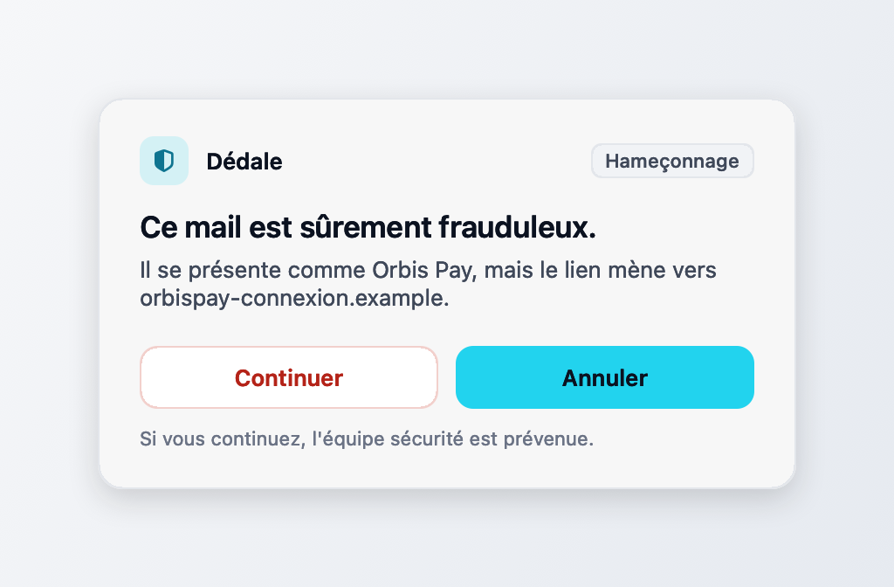

# Dédale pour Mac (démo)

Une petite application de barre de menus. Elle tourne en arrière-plan sur le poste et affiche une pop-up quand on lui signale un geste à risque. Le salarié choisit : Annuler (le geste est abandonné, aucun incident) ou Continuer (le SOC reçoit l'événement et ouvre un incident).

L'application ne surveille rien sur le Mac. Elle ne lit ni les mails, ni le presse-papiers, ni l'écran. Les gestes viennent du simulateur `poste/` ou d'un `curl` sur un port local, et aucune permission système n'est demandée.



## Lancer

Il faut macOS 13 ou plus et Swift 5.9 ou plus (Xcode ou les outils en ligne de commande).

```bash
cd app-mac
./construire.sh            # construit Dedale.app
./construire.sh --lancer   # construit puis ouvre l'app
```

Un bouclier apparaît dans la barre de menus, sans icône dans le Dock. Son menu affiche l'état du SOC (« Connecté au SOC » ou « Hors ligne », vérifié toutes les 5 s sur `/api/mesures`) et propose « Tester une alerte » et « Quitter ». Pour que les incidents remontent, lancez aussi le backend : `./lancer.sh` à la racine, ou `cd backend && uv run uvicorn app.main:app --port 8700`.

## Tester

```bash
curl -X POST 127.0.0.1:8712/avertir -d '{
  "categorie": "phishing",
  "message": "Ce mail est sûrement frauduleux.",
  "detail": "Il se présente comme Orbis Pay, mais le lien mène vers orbispay-connexion.example.",
  "session_id": "poste-mac-demo-0001"
}'
# {"id":"…","session_id":"poste-mac-demo-0001","statut":"affichee"}
```

Cliquez Continuer, puis :

```bash
curl -s 127.0.0.1:8700/api/incidents | python3 -m json.tool | grep poste-mac-demo-0001
```

L'incident `humain_phishing` y figure. Après Annuler, le backend compte un geste arrêté et n'ouvre pas d'incident.

`categorie` vaut `phishing`, `secret`, `mail_externe`, `upload_ia` ou `intrusion_physique`, et `message` est obligatoire. Le reste est facultatif : `detail`, `session_id` (`poste-mac-demo` par défaut), ainsi que `gravite`, `cible` et `lien`, transmis tels quels au backend. `GET /etat` renvoie l'état de l'app. Les alertes s'affichent une par une, dix au plus en attente.

L'événement envoyé suit `CONTRATS.md`, avenant « humain » : `source: humain`, `surface: poste`, `type: avertissement`, `details.categorie`, `details.choix`, et `details.message` qui porte le texte de la pop-up.

## Variables de test

| Variable | Effet |
|---|---|
| `DEDALE_BACKEND` | adresse du backend, `http://127.0.0.1:8700` par défaut |
| `DEDALE_CLIC_AUTO` | `continuer` ou `annuler` : l'app appuie sur ce bouton (`performClick`) après un délai, sans souris |
| `DEDALE_CLIC_DELAI` | ce délai en secondes, 2 par défaut |
| `DEDALE_CAPTURE` | dossier où l'app écrit un PNG de sa pop-up, avant et après le choix |

Elles se passent au binaire : `DEDALE_CLIC_AUTO=continuer ./Dedale.app/Contents/MacOS/Dedale`.

## Limites

- C'est une démo. Rien n'est observé sur le Mac et Annuler ne bloque rien, puisque le geste est simulé.
- Le port 8712 n'écoute que sur 127.0.0.1. Il refuse les requêtes qui portent un en-tête `Origin` ou `Sec-Fetch-*`, ainsi que tout hôte autre que 127.0.0.1 ou localhost : une page web ne peut pas afficher de fausse alerte. Un programme local le peut, faute d'authentification.
- Sans backend, la pop-up s'affiche quand même et l'app tient, mais l'événement est perdu : il n'y a pas de file de renvoi.
- Entrée et Échap valent Annuler, une seconde après l'apparition seulement, pour qu'une frappe en cours dans une autre fenêtre ne ferme pas l'alerte.
- La capture PNG est rendue par l'app : le flou du verre n'y apparaît pas, seulement le voile blanc.
- L'app est signée ad hoc. Copiée sur un autre Mac, elle s'ouvre par clic droit, Ouvrir.
