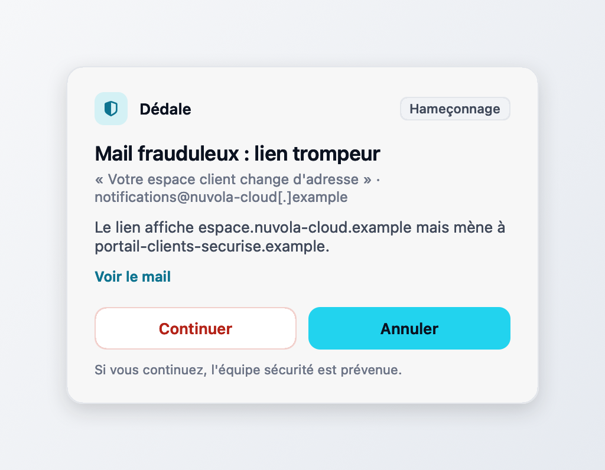
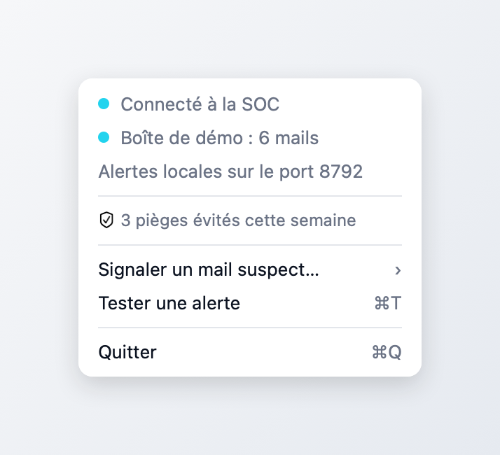
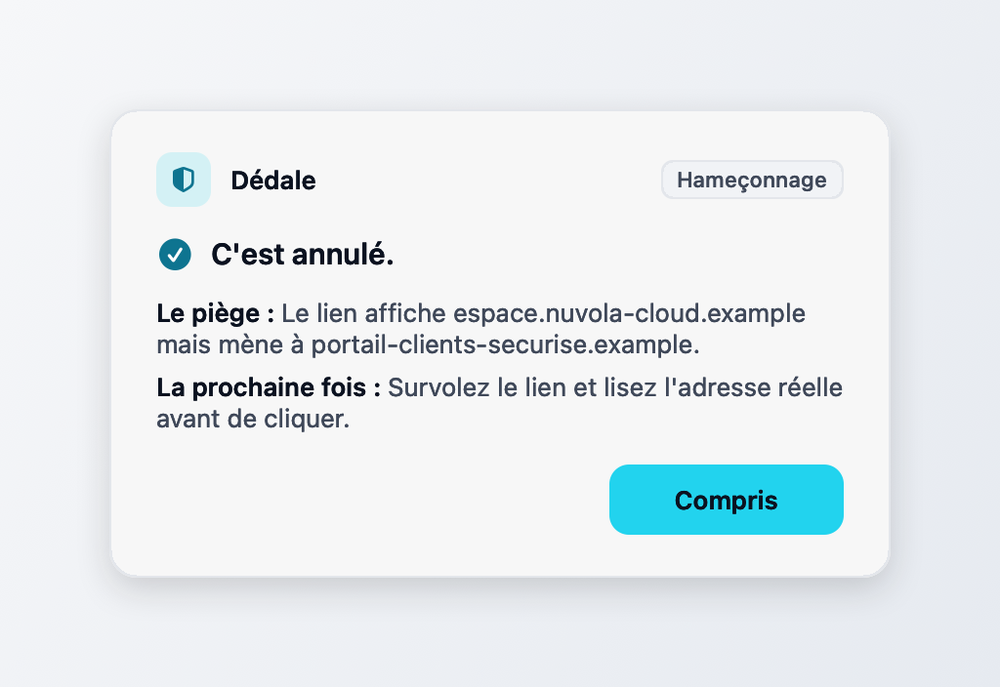
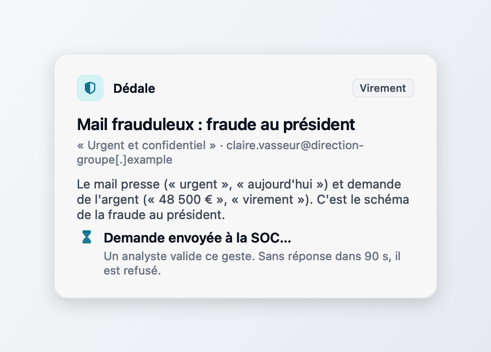
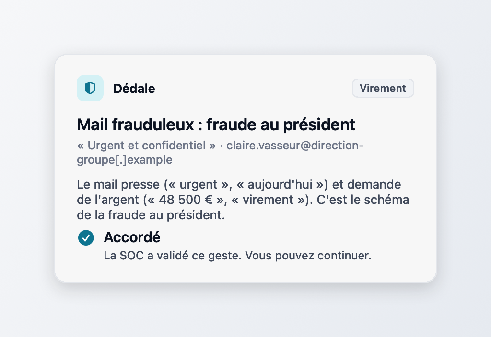
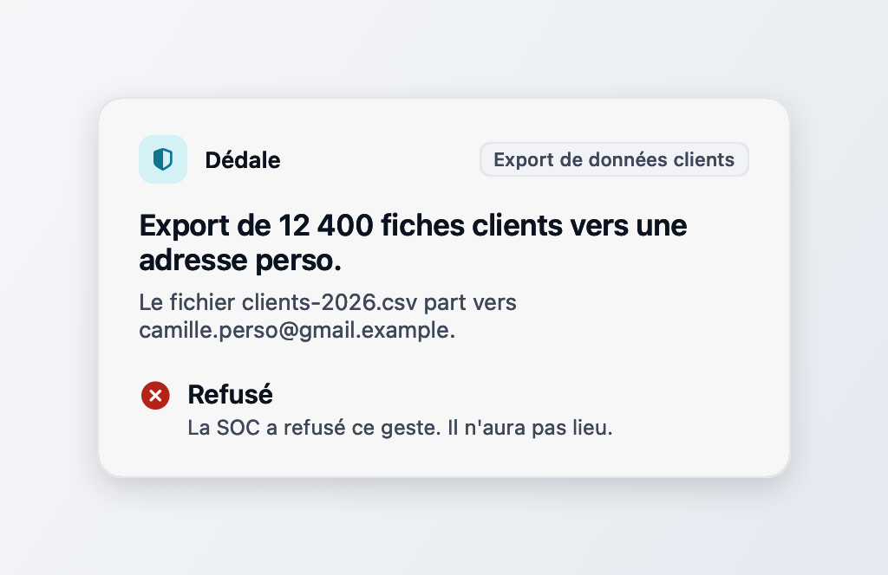
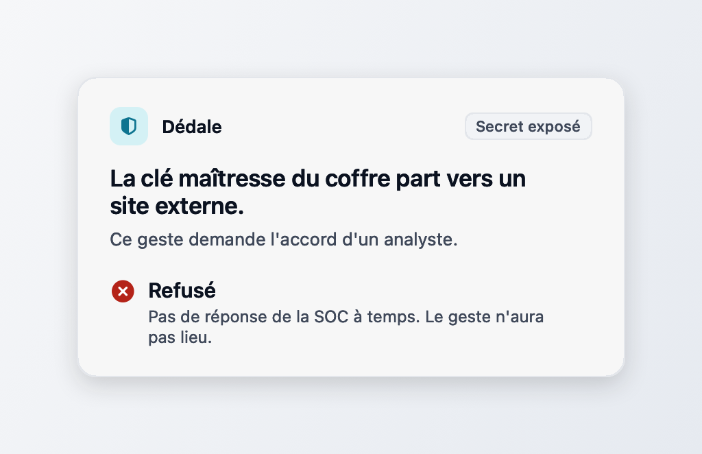

# Dédale pour Mac (démo)

Une application de barre de menus. Elle affiche une pop-up quand un geste à risque se présente : un mail frauduleux arrivé dans la boîte de démo, ou un geste signalé sur le port local. Le salarié choisit Annuler ou Continuer. Après Annuler, un court coach explique le piège. Un geste critique (virement, export de données clients) attend l'accord d'un analyste du SOC.

L'application ne surveille rien sur le Mac. Elle ne lit ni la messagerie du Mac, ni le presse-papiers, ni l'écran. Les mails viennent de la boîte de démo locale (`messagerie/`), les autres gestes du simulateur `poste/` ou d'un `curl`, et aucune permission système n'est demandée.



## Lancer

Il faut macOS 13 ou plus et Swift 5.9 ou plus (Xcode ou les outils en ligne de commande).

```bash
cd app-mac
./construire.sh            # construit Dedale.app
./construire.sh --lancer   # construit puis ouvre l'app
```

Un bouclier apparaît dans la barre de menus, sans icône dans le Dock. Pour la démo complète, lancez aussi le backend (`./lancer.sh` à la racine) et la boîte de démo :

```bash
cd messagerie
./demarrer.sh --service                     # Mailpit (8716, SMTP 8717) et service de verdicts (8715)
uv run python envoyer_demo.py --cas sosie   # fait arriver un mail piégé
```

## Le menu

- « Connecté à la SOC » ou « SOC hors ligne » (sonde `/api/mesures` toutes les 5 s).
- « Boîte de démo : 6 mails » ou « Boîte de démo hors ligne ».
- Le compteur : « 3 pièges évités cette semaine ». Chaque Annuler compte, depuis lundi. Les dates restent sur le Mac, dans `~/Library/Application Support/Dedale/pieges-evites.json`.
- « Signaler un mail suspect… », « Tester une alerte », « Quitter ».



## Mails frauduleux

L'app s'abonne au flux `GET /flux` de `messagerie/` et relève `GET /verdicts` toutes les 3 s en secours. Chaque nouveau mail jugé `frauduleux` ouvre la pop-up : le titre de l'alerte, l'objet et l'adresse de l'expéditeur, puis une ou deux raisons en clair. Un mail `suspect` n'ouvre rien. Les mails déjà là au lancement de l'app ne rejouent pas d'alerte.

« Voir le mail » ouvre un aperçu désarmé à côté de la pop-up ([capture](captures/apercu-mail.png)). Le corps est du texte brut : aucun HTML n'est rendu, rien ne se charge, les liens sont réécrits (`hxxps://`, `[.]`) et ne se cliquent pas. Sous le corps, l'aperçu montre où mènent vraiment les liens, les pièces jointes (jamais ouvertes) et le texte caché que l'analyseur a relevé.

Le choix du salarié part au backend dans la session `mail-<id>`, celle où `messagerie/` a déjà déposé le mail reçu. Un Continuer ouvre donc l'incident `humain_phishing` avec le mail en contexte.

Sans la boîte de démo, rien ne casse : le menu affiche « Boîte de démo hors ligne » ([capture](captures/menu-hors-ligne.png)) et l'app réessaie.

## Le coach, après Annuler

La pop-up devient une explication de trois lignes : « C'est annulé. », le piège, et comment le repérer la prochaine fois. « Compris » la ferme, sinon elle part seule au bout de 30 s pour ne pas bloquer les alertes suivantes.



Le piège vient de la première raison du verdict, ou du `detail` de l'alerte. Le repère vient du code du signal le plus lourd (`lien_menteur`, `sosie_domaine`, `urgence_argent`…), sinon d'un petit catalogue par catégorie dans `Coach.swift` ([capture hors mail](captures/popup-coach.png)).

## Signaler un mail suspect

Le sous-menu liste les 8 derniers mails de la boîte ([capture](captures/menu-signaler.png)). Un clic envoie un événement `signalement` au backend, avec le mail désarmé en `document_source`, puis affiche « Merci, la SOC est prévenue. » ([capture](captures/signalement.png)). Le mail signalé prend une coche. Le format est dans `CONTRATS.md`, section « app Mac, signalement et quatre yeux ».

## Les quatre yeux

Une alerte de gravité `critique` ne passe pas sur le seul Continuer. C'est le cas d'un mail qui réclame un virement (le verdict porte `geste: virement`), d'un mail que l'analyseur juge critique, ou d'un `POST /avertir` avec `"gravite": "critique"`. La note sous les boutons le dit avant le choix.

Après Continuer, la pop-up passe en « Demande envoyée à la SOC… » avec le temps restant. L'app ouvre l'incident au backend et attend la décision de l'analyste dans la console : « Classer sans suite » (`ignorer`) accorde le geste, « Clore le dossier » (`clore`) le refuse. Sans décision en 90 s, ou si le backend est injoignable, le geste est refusé. L'issue entre dans la boîte noire de l'incident.

| En attente | Accordé | Refusé | Sans réponse |
|---|---|---|---|
|  |  |  |  |

## Tester sans la boîte de démo

```bash
curl -X POST 127.0.0.1:8712/avertir -d '{
  "categorie": "phishing",
  "message": "Ce mail est sûrement frauduleux.",
  "detail": "Il se présente comme Orbis Pay, mais le lien mène vers orbispay-connexion.example.",
  "session_id": "poste-mac-demo-0001"
}'
# {"id":"…","session_id":"poste-mac-demo-0001","statut":"affichee"}

# Un geste critique, qui attend l'accord de la SOC :
curl -X POST 127.0.0.1:8712/avertir -d '{
  "categorie": "mail_externe", "geste": "export_clients", "gravite": "critique",
  "message": "Export de 12 400 fiches clients vers une adresse perso.",
  "session_id": "poste-mac-camille"
}'
```

`categorie` vaut `phishing`, `secret`, `mail_externe`, `upload_ia` ou `intrusion_physique`, et `message` est obligatoire. Le reste est facultatif : `detail`, `session_id` (`poste-mac-demo` par défaut), `geste` (`virement` ou `export_clients`, change le libellé et le conseil du coach), ainsi que `gravite`, `cible` et `lien`, transmis au backend. `GET /etat` renvoie l'état de l'app (SOC, boîte de démo, alerte affichée, file, quatre yeux en attente, pièges évités). Les alertes s'affichent une par une, dix au plus en attente.

L'événement envoyé suit `CONTRATS.md`, avenant « humain » : `source: humain`, `surface: poste`, `type: avertissement`, `details.categorie`, `details.choix`, et `details.message` qui porte le texte de la pop-up.

## Variables

| Variable | Effet |
|---|---|
| `DEDALE_BACKEND` | adresse du backend, `http://127.0.0.1:8700` par défaut |
| `DEDALE_MESSAGERIE` | adresse du service de verdicts, `http://127.0.0.1:8715` par défaut |
| `DEDALE_PORT_LOCAL` | port des alertes locales, 8712 par défaut |
| `DEDALE_QUATRE_YEUX_DELAI` | secondes d'attente de la décision du SOC, 90 par défaut (5 à 600) |
| `DEDALE_MAILS_AU_DEMARRAGE` | `alerter` rejoue les mails frauduleux déjà présents au lancement |
| `DEDALE_ETAT` | dossier du compteur de pièges évités |
| `DEDALE_CLIC_AUTO` | boutons à presser seuls, dans l'ordre, séparés par des virgules : `voir`, `annuler`, `continuer`, `compris`. Chaque clic passe par le vrai bouton (`performClick`) |
| `DEDALE_CLIC_DELAI` | délai avant chaque clic automatique, 2 s par défaut |
| `DEDALE_SIGNALER_AUTO` | identifiant d'un mail (ou `premier`) à signaler une fois, par le même chemin qu'un clic dans le menu |
| `DEDALE_CAPTURE` | dossier où l'app écrit un PNG de chaque état de ses fenêtres et un rendu de son menu |

Elles se passent au binaire : `DEDALE_CLIC_AUTO=voir,annuler,compris ./Dedale.app/Contents/MacOS/Dedale`.

## Vérifier sans toucher à la démo

Les captures de `captures/` viennent de l'app elle-même, contre un backend isolé et une boîte de démo à part :

```bash
# backend sur une base jetable, port 8781
cd backend && DEDALE_DB=/tmp/dedale-test.db DEDALE_LLM=off uv run uvicorn app.main:app --port 8781
# Mailpit et service de verdicts sur 8786, 8787 et 8785
mailpit --listen 127.0.0.1:8786 --smtp 127.0.0.1:8787 --database /tmp/mailpit-test.db
cd messagerie && MESSAGERIE_MAILPIT=http://127.0.0.1:8786 DEDALE_BACKEND=http://127.0.0.1:8781 \
  uv run uvicorn service:app --port 8785
# l'app, sur un autre port local que l'instance de démo
cd app-mac && swift build -c release && DEDALE_BACKEND=http://127.0.0.1:8781 \
  DEDALE_MESSAGERIE=http://127.0.0.1:8785 DEDALE_PORT_LOCAL=8792 DEDALE_ETAT=/tmp/dedale-etat \
  DEDALE_CAPTURE=captures DEDALE_CLIC_AUTO=voir,annuler,compris .build/release/Dedale
# un mail piégé arrive
cd messagerie && uv run python envoyer_demo.py --port 8787 --cas lien_menteur
```

Lancé depuis `.build/release/`, le binaire n'a pas d'identifiant de paquet : il tourne à côté d'une instance de `Dedale.app` déjà ouverte. Pour les quatre yeux, prendre la décision par `POST /api/incidents/{id}/decision` sur le backend isolé.

## Limites

- C'est une démo. Rien n'est observé sur le Mac, et Annuler ou un refus du SOC ne bloquent rien, puisque le geste est simulé.
- Le port local n'écoute que sur 127.0.0.1. Il refuse les requêtes qui portent un en-tête `Origin` ou `Sec-Fetch-*`, ainsi que tout hôte autre que 127.0.0.1 ou localhost : une page web ne peut pas afficher de fausse alerte. Un programme local le peut, faute d'authentification.
- Sans backend, la pop-up s'affiche quand même et l'app tient, mais l'événement est perdu : il n'y a pas de file de renvoi. Un geste critique est alors refusé.
- Une décision du SOC qui arrive après le délai des quatre yeux ne change plus rien sur le poste. Dans `/api/mesures`, la demande compte comme un geste passé outre, même refusée.
- Entrée et Échap valent Annuler, une seconde après l'apparition seulement, pour qu'une frappe en cours dans une autre fenêtre ne ferme pas l'alerte. Dans le coach, ils valent Compris.
- Les PNG sont rendus par l'app : le flou du verre n'y apparaît pas, seulement le voile blanc. Le menu est redessiné à partir de ses lignes, ce n'est pas une capture d'écran du système.
- L'app est signée ad hoc. Copiée sur un autre Mac, elle s'ouvre par clic droit, Ouvrir.
